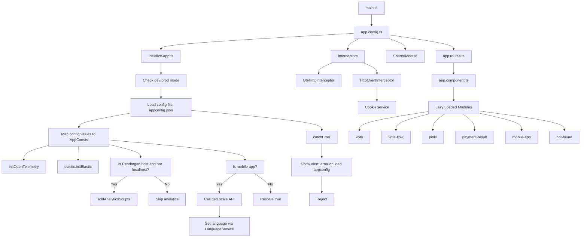

# App Directory — راهنمای ساختار پروژه با ترتیب دقیق راه‌اندازی (Bootstrap Flow)

این مستند به صورت گام به گام توضیح می‌دهد که هنگام اجرای برنامه چه بخش‌هایی، در چه زمانی، و به چه منظور لود می‌شوند.

---

## ۱. main.ts

- نقطه شروع برنامه.
- اجرای `bootstrapApplication` و بارگذاری پیکربندی‌های اصلی از `app.config.ts`.

## ۲. app.config.ts

- بارگذاری کل پیکربندی‌ها و provider های اصلی:
  - **App Initializer:**  
    اجرای `initialize-app.ts` برای آماده‌سازی اولیه.
  - **Routing:**  
    بارگذاری مسیرهای اپلیکیشن از `app.routes.ts`.
  - **HTTP Client:**  
    راه‌اندازی HTTP client به همراه interceptorهای ثبت‌شده.
  - **ترجمه:**  
    بارگذاری ترجمه‌ها با استفاده از `ngx-translate`.
  - **انیمیشن‌ها، اعلان‌ها و سایر ماژول‌های عمومی:**  
    ماژول‌های Toastr, Material, Shared, Captcha, Alert Modal, APM.
  - **Error Handler ها:**  
    `MyErrorHandler` و `ApmErrorHandler`.
  - **Interceptor ها:**
    - `OtelHttpInterceptor`
    - `HttpClientInterceptor` (وابسته به CookieService از پوشه `vote/services`)

---

## ۳. initialize-app.ts

این فایل وظیفه انجام تنظیمات اولیه اپلیکیشن را بر عهده دارد و پیش از اجرای اصلی برنامه اجرا می‌شود.

### وظایف اصلی:

- **خواندن پیکربندی اپلیکیشن از فایل config**

  - فایل `appconfig.json` (در حالت توسعه) یا `appconfig.production.json` (در حالت تولید) خوانده می‌شود.
  - مقادیر کلیدی مثل آدرس‌های API، فایل سرور، کلیدهای reCaptcha و اطلاعات ElasticSearch خوانده و در سطح اپلیکیشن (`AppConsts`) ذخیره می‌شوند.

- **پیکربندی سرویس‌های اصلی**

  - مقداردهی اولیه سرویس ElasticSearch برای مانیتورینگ و لاگ‌ها.
  - راه‌اندازی OpenTelemetry برای رهگیری و مشاهده عملکرد.
  - افزودن اسکریپت‌های آنالیتیکس (مانند Clarity یا Google Analytics) فقط در دامنه‌های مجاز و خارج از localhost.

- **مدیریت زبان و جهت صفحه**

  - در نسخه موبایل، زبان رابط کاربری با استفاده از API جداگانه (`getLocale`) تنظیم می‌شود.

- **مدیریت خطاها**
  - در صورت بروز خطا هنگام خواندن فایل config، خطا در کنسول لاگ می‌شود و یک پیام هشدار از طریق `ngx-alert-modal` نمایش داده می‌شود.

### نکات تکمیلی:

- برای جلوگیری از کش شدن فایل config، در پایان URL آن یک query string تصادفی اضافه می‌شود.
- زمان اجرای عملیات‌های کلیدی (`appInit`, `getLocale`) با استفاده از `console.time` و `console.timeEnd` اندازه‌گیری و در کنسول ثبت می‌شود.
- با توجه به مقدار `host` از config، اسکریپت‌های تحلیلی تنها زمانی اضافه می‌شوند که دامنه سایت Pendargan و غیر از `localhost` باشد.
- با استفاده از تزریق وابستگی (`inject`) در Angular، سرویس‌های مورد نیاز در ابتدای اجرا فراهم می‌شوند.

### وابستگی‌ها:

- Angular Core (`inject`, `isDevMode`)
- HttpClient برای خواندن فایل‌های پیکربندی و درخواست‌های API
- `LanguageService` برای مدیریت زبان رابط کاربری
- `NgxAlertModalService` برای نمایش هشدارها
- ElasticService برای اتصال به سرویس Elastic
- تابع `initOpenTelemetry` برای راه‌اندازی سرویس مانیتورینگ
- تابع `addAnalyticsScripts` برای اضافه کردن اسکریپت‌های آنالیتیکس

---

## ۴. app.routes.ts

- تعریف مسیرهای مختلف (Routing) برنامه.
- تعیین اینکه چه بخش‌هایی به صورت lazy-load بارگذاری شوند.

---

## ۵. Interceptors

- **otelHttpInterceptor.ts**  
  مدیریت تله‌متری و لاگ کردن درخواست‌ها.
- **http.interceptor.ts**  
  مدیریت درخواست‌های API شامل:
  - اضافه کردن هدرهای لازم (مثل توکن‌ها)
  - مدیریت کوکی‌ها از طریق `CookieService`

---

## ۶. Shared Module

- **shared/shared.module.ts**  
  بارگذاری سرویس‌ها و کامپوننت‌های مشترک.

---

## ۷. vote/services/cookie.service.ts

- سرویس مدیریت کوکی‌ها برای ذخیره و خواندن اطلاعات حیاتی کاربر.

---

## ۸. app.component.ts

- ریشه‌ی رابط کاربری اپلیکیشن.
- نمایش بخش‌های مختلف بر اساس مسیر انتخاب‌شده.
- مدیریت لایه‌های اصلی UI (Loader, Layout, و غیره).

فایل‌های مرتبط:

- **app.component.html** — قالب UI
- **app.component.scss** — استایل‌ها
- **app.component.spec.ts** — تست‌های کامپوننت

---

## ۹. سایر بخش‌های Lazy-Load (بر اساس مسیر انتخاب شده)

- **polls/**  
  ماژول مدیریت نظرسنجی‌ها.
- **vote/**  
  مدیریت رای‌گیری‌ها.
- **vote-flow/**  
  کنترل جریان مراحل رای‌گیری.
- **payment-result/**  
  نمایش نتیجه تراکنش‌های پرداخت.
- **text-number/**  
  مدیریت پیام‌های متنی.
- **mobile-app/**  
  تنظیمات و صفحات اپلیکیشن موبایل.
- **not-found/**  
  صفحه نمایش 404 برای مسیرهای نامعتبر.

---

## جریان کلی راه‌اندازی

---

## نکات تکمیلی

- **initialize-app.ts** در مرحله App Initializer اجرا می‌شود، به این معنی که قبل از Bootstrap اصلی اپلیکیشن آماده‌سازی‌ها انجام می‌شوند.
- ساختار پروژه به گونه‌ای طراحی شده است که توسعه و نگهداری آن آسان باشد.
- لطفاً هنگام ایجاد تغییرات در ساختار یا مسیرهای پروژه، این مستند را نیز به‌روزرسانی کنید.

---

با ❤️ توسط تیم توسعه

